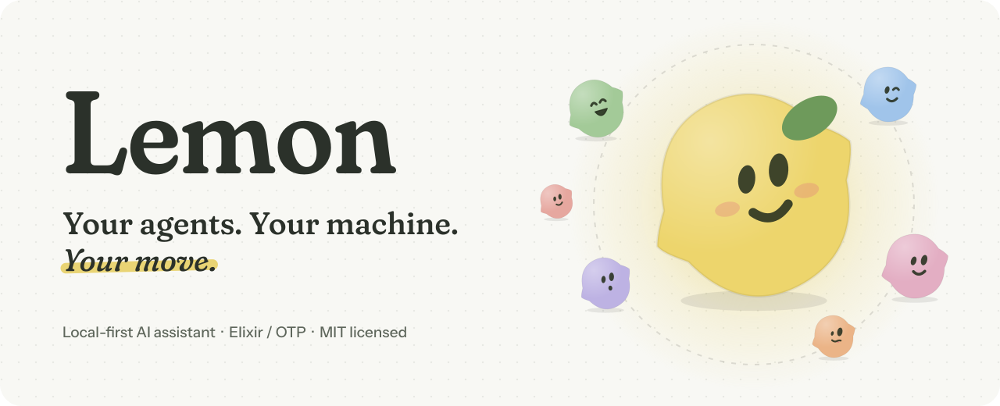

<div align="center">



# Lemon 🍋

**A coding agent that never clocks out.**<br>
Pair with it in your terminal, hand it work from your phone, and let it keep going while you sleep,
all on a runtime you own.

[Docs](https://z80dev.github.io/lemon/) · [Quickstart](docs/getting-started/quickstart.md) · [Releases](https://github.com/z80dev/lemon/releases) · [Changelog](CHANGELOG.md)

<a href="LICENSE"></a>
<a href="https://z80dev.github.io/lemon/"></a>


</div>

Most coding agents are a single process attached to one terminal tab: close the
tab, lose the agent. Lemon is a **daemon**. Your sessions, memory, skills,
schedules, and subagents live in a supervised Elixir/OTP runtime on your machine.
The TUI, browser, CLI, Telegram, and Discord all connect to that same runtime, so
you can start a refactor at your desk, steer it from your phone, and come back to
a reviewed diff.

<table>
<tr><td><b>A real coding agent</b></td><td>Reads, edits, patches, greps (including <code>ast_grep</code>), runs shells, searches the web, and checks diagnostics. Plan mode, approvals, <code>/rewind</code> with file restore, checkpoints, and a git changes viewer keep every edit reviewable.</td></tr>
<tr><td><b>One brain, many doors</b></td><td>The same session from a terminal TUI, a full web workspace, scripted <code>lemon -p</code> runs, Tern panes, Telegram, and Discord. Follow up, <b>steer</b>, or <b>redirect</b> a running turn from any of them.</td></tr>
<tr><td><b>Parallel by design</b></td><td><code>task</code> fans work out to child sessions (read-only <code>scout</code> and <code>reviewer</code> ship built in). Kanban tasks dispatch into their own git worktrees. Hand jobs to <a href="docs/user-guide/omp.md">omp</a> or to a named execution node on another machine.</td></tr>
<tr><td><b>Gets better with use</b></td><td><code>remember</code> and <code>recall</code> give it durable memory across sessions. Successful runs become draft skills, and routing feedback learns which model wins at what. Profiles keep work, home, and side projects separate.</td></tr>
<tr><td><b>Keeps working without you</b></td><td>Goals continue on their own within budgets, a judge checks progress, and cron jobs and heartbeats run unattended and report back to Telegram.</td></tr>
<tr><td><b>Any model, no lock-in</b></td><td>Sign in with ChatGPT or Claude Pro/Max, or bring keys for Anthropic, OpenAI, Gemini/Vertex, Bedrock, Azure, Mistral, OpenRouter, Groq, DeepSeek, xAI, Kimi, Qwen, or any OpenAI-compatible endpoint, local models included.</td></tr>
<tr><td><b>Built not to fall over</b></td><td>Every run, conversation, and tool call is its own supervised BEAM process. A crashing tool becomes an error the model can read, a provider outage trips that provider's circuit breaker, and a retry never sends the same message twice.</td></tr>
</table>

## Install

macOS (Apple Silicon) or Linux:

```bash
curl -fsSL https://raw.githubusercontent.com/z80dev/lemon/main/install.sh | sh -s -- --skip-setup
export PATH="$HOME/.lemon/bin:$PATH"
lemon setup
```

Prebuilt releases bundle the runtime and TUI; you don't need Elixir. In setup, pick
**OpenAI Codex → Sign in with ChatGPT**, **Anthropic → Sign in with Claude
Pro/Max**, explicitly import an existing Codex CLI login, or enter any provider API
key. Coming from Hermes? Run `lemon migrate hermes --dry-run` and see the
[migration guide](docs/user-guide/migrate-from-hermes.md).

## Your first session

Open a terminal in a repository and run `lemon`. It starts the daemon or reuses a
running one, then opens the TUI. Try:

> Read the repository instructions. Find how to run the tests. Add the test
> command to README if missing, run the focused tests, and show the diff.

**Ctrl+O** picks a model, **Ctrl+X** reopens a past session, and **Esc** stops
the turn. Pressing **Ctrl+C** twice quits the TUI but leaves the daemon and its
work running. The [coding quickstart](docs/getting-started/quickstart.md) covers
the full first-run workflow.

## What you can do with it

### Code with it

The usual edit-run-review loop, with guardrails that make a long-running agent
safe to trust:

- **`/plan`** plans read-only and asks for approval before executing.
- **Approvals** cover a single call, the session, the agent, or every session.
  Resolve them in the TUI, the web UI, or with Telegram buttons.
- **`/rewind`** previews and confirms a history change. `/rewind --files` also
  restores checkpointed files, and `/tree` browses preserved branches.
- **`@file:`, `@folder:`, `@git-diff`, `@url:`, `@session:`** pull bounded context
  into a prompt. External content is fenced as untrusted data.
- **`/compact`** and **`/context`** show where the context window goes and let
  you choose what to keep.
- **MCP servers, skills, and project `AGENTS.md`** extend the toolset. Run
  `lemon mcp list` to see configured servers.

### Run work in parallel

> Use two task children in parallel: a scout to locate the tests and a reviewer
> to inspect edge cases. Summarize their findings; do not edit files.

Children share the parent's model and tool stack, and `/tasks` shows them live.
Define your own personas in `.lemon/agents/`. For larger efforts, ask for a
**kanban board**: git-backed tasks dispatch to workers in separate worktrees, and
you review and merge the results. Say "run this in omp" to delegate to an
[omp](https://github.com/can1357/oh-my-pi) session that Lemon monitors, steers,
and can resume. [Named execution nodes](docs/architecture/overview.md) run a job
on another machine with that machine's own workspace and credentials.

### Reach it from anywhere

| Surface | How | Good for |
| --- | --- | --- |
| Terminal | `lemon` | Hands-on coding |
| Browser | `lemon web` | Diffs, tool cards, automation boards, usage, ⌘K palette, phone layout |
| Scripts & CI | `lemon -p "…" --output json` | One-shot runs that return machine-readable results and exit nonzero on failure |
| Tern | `lemon` in a pane, or `lemon tern install` | Native Tern surfaces and ACP chat |
| Telegram | `lemon gateway setup telegram`, then message the bot | `/help`, `/new`, `/resume`, `/model`, `/steer`, `/cancel`, `/file`, approval buttons; public commands in the `/` menu |
| Discord | `lemon gateway setup discord`, then mention the bot | `/help`, `/session`, `/model`, `/resume`, `/file`, `/checkpoint`, `/goal`, mention-triggered runs and threads |

Sessions persist across every surface. One run can start from Telegram and you
can review it later in the web UI.

### Let it remember

- **Memory:** say "remember that we deploy from `release/*`". Lemon writes the
  fact to user or project memory and recalls relevant memories automatically
  in later sessions.
- **Skills:** `SKILL.md` bundles load on demand. Lemon drafts new skills from
  successful runs. `lemon learn` turns files, folders, and URLs into memory and a
  draft skill, and writes nothing until you confirm the review.
- **Profiles:** each profile has its own workspace and canonical conversation,
  for example one for work, one for personal use, and one for your homelab.

See [memory](docs/user-guide/memory.md), [skills](docs/user-guide/skills.md),
[learning](docs/user-guide/learn-from-sources.md),
[adaptive routing](docs/user-guide/adaptive.md) and
[profiles](docs/user-guide/profiles.md).

### Put it on autopilot

- **Goals:** "Raise test coverage in `lib/parser` to 90%." The goal continues on
  its own within a continuation budget while a judge checks progress.
- **Cron:** `every 30m`, `weekdays at 09:30`, or any 5-field expression. Jobs run
  in isolated sessions with their own audit trail.
- **Heartbeats:** `/heartbeat every 1h check CI and summarize failures` sends the
  result to Telegram and stays quiet when nothing needs attention.

Goals, kanban dispatch, and cron are **preview** features; check the
[support boundaries](docs/support.md) before relying on them unattended. See
[automation](docs/user-guide/reminders-and-heartbeats.md).

## Why Lemon

**It is a runtime, not a REPL.** Close the terminal and your agents keep running.
Reopen it and every session is still there. Telegram, the web UI, and cron all
talk to the same process tree, with no second copy of your state to keep in sync.

**It fails small.** Agent systems are really a concurrency problem: many
long-lived conversations talking to unreliable services. Lemon runs on the BEAM,
which was built for exactly that:

- A conversation is a process. A 200k-token session garbage-collects on its own
  heap and never stalls the others.
- A crashed tool call becomes a tool result, and the rest of its parallel batch
  keeps running.
- Crashed runs are deliberately **not** replayed, because replaying a turn would
  repeat its file writes and messages.
- Outbound messages carry idempotency keys, and every provider has its own
  circuit breaker.

[Agents are a concurrency problem](docs/why-beam-for-agents.md) explains the
design and its costs.

**It treats you as the operator.** Destructive actions show a preview before
confirmation. Credentials live in an encrypted store backed by Keychain. Tool
output and skills are handled as data, never as instructions. `lemon doctor`
diagnoses problems, and you also get verified backups and update plans with
rollback. Read the [safety model](docs/security/safety.md).

**It's yours.** MIT licensed and self-hosted. Lemon is local-first but not
local-only: your configured providers receive the data their requests need.

## Command cheat sheet

```bash
lemon                 # TUI in the current directory (starts or reuses the daemon)
lemon -p "…"          # one-shot run; add --output json|stream-json
lemon web             # browser workspace
lemon setup           # providers and defaults (safe to re-run)
lemon model           # switch provider or model
lemon doctor          # diagnose config, credentials, and runtime health
lemon sessions        # list and manage stored sessions
lemon omp start       # delegate a task to omp
lemon mcp list        # inspect MCP servers
lemon backup          # verified backups
lemon status | stop | restart
```

Full reference: [CLI guide](docs/user-guide/cli.md), [TUI](clients/tui/README.md),
[web](docs/user-guide/web.md), [configuration](docs/config.md).

## Status

Lemon is **pre-1.0**. Stable: TUI, web UI, CLI, the control plane, and text-first
Telegram and Discord on macOS and Linux. Browser automation, LSP diagnostics,
checkpoints, media generation, ACP, goals, kanban, and cron are previews.
[Support boundaries](docs/support.md) lists exactly what is stable, and
[Is Lemon right for you?](docs/compare.md) covers the tradeoffs.

## LemonSim

The repository also contains **LemonSim**: deterministic, event-sourced worlds
where models play each other. Use it to watch agents and to benchmark model
behavior with replay-verifiable results. Try it with no API keys:

```bash
mix sim_ui.assets.setup && mix sim_ui.assets.build
mix lemon.sim.demo --seed 42
```

See [LemonSim](apps/lemon_sim/README.md) and the
[benchmark quickstart](docs/benchmarks/quickstart.md).

## Develop from source

Requires Erlang/OTP 28.5+, Elixir 1.19.5+, and Bun 1.3.14+ (TUI). Node.js 24+ is
used for docs and the browser client.

```bash
git clone https://github.com/z80dev/lemon.git && cd lemon
mix local.hex --force && mix deps.get && mix compile
./bin/lemon setup && ./bin/lemon
```

Run `scripts/test fast` and `scripts/test quality` from the root. See
[testing](docs/testing.md), [architecture](docs/architecture/overview.md),
[contributing](CONTRIBUTING.md), the [agent guide](AGENTS.md), and
[security](SECURITY.md).

---

Inspired by [pi](https://github.com/badlogic/pi-mono),
[oh-my-pi](https://github.com/can1357/oh-my-pi), [takopi](https://github.com/banteg/takopi),
OpenClaw and Ironclaw. The skill library was bootstrapped from
[Hermes Agent](https://github.com/NousResearch/hermes-agent).
[MIT licensed](LICENSE). Named after a very good cat.
