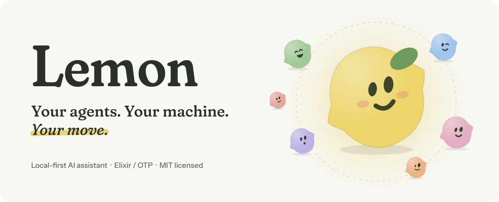

<div align="center">



# Lemon 🍋

**A coding agent that never clocks out.**<br>
Pair with it in your terminal, hand it work from your phone, and let it keep going while you sleep,
all on a runtime you own.

[Docs](https://lemon.food/) · [Quickstart](docs/getting-started/quickstart.md) · [Releases](https://github.com/z80dev/lemon/releases) · [Changelog](CHANGELOG.md)

<a href="LICENSE"></a>
<a href="https://lemon.food/"></a>


</div>

Most coding agents are a single process attached to one terminal tab: close the
tab, lose the agent. Lemon is a **daemon**. Your sessions, memory, skills,
schedules, and subagents live in a supervised Elixir/OTP runtime on your machine.
The TUI, browser, CLI, Telegram, and Discord all connect to that same runtime, so
you can start a refactor at your desk, steer it from your phone, and come back to
a reviewed diff.

<table>
<tr><td><b>A real coding agent</b></td><td>Reads, edits, patches, greps (including <code>ast_grep</code>), runs shells, searches the web, and checks diagnostics. Plan mode, approvals, <code>/rewind</code> with file restore, checkpoints, and a git changes viewer keep every edit reviewable.</td></tr>
<tr><td><b>One brain, many doors</b></td><td>The same session from a terminal TUI, a full web workspace, scripted <code>lemon -p</code> runs, Tern panes, Telegram, and Discord. Follow up, <b>steer</b>, or <b>redirect</b> a running turn from any of them.</td></tr>
<tr><td><b>Parallel by design</b></td><td><code>task</code> fans work out to child sessions (read-only <code>scout</code> and <code>reviewer</code> ship built in). Kanban tasks dispatch into their own git worktrees. Hand jobs to <a href="docs/user-guide/omp.md">omp</a> or to a named execution node on another machine.</td></tr>
<tr><td><b>Gets better with use</b></td><td><code>remember</code> and <code>recall</code> give it durable memory across sessions. Successful runs become draft skills, and routing feedback learns which model wins at what. Profiles keep work, home, and side projects separate.</td></tr>
<tr><td><b>Keeps working without you</b></td><td>Goals continue on their own within budgets, a judge checks progress, and cron jobs and heartbeats run unattended and report back to Telegram.</td></tr>
<tr><td><b>Any model, no lock-in</b></td><td>Sign in with ChatGPT or Claude Pro/Max, or bring keys for Anthropic, OpenAI, Gemini/Vertex, Bedrock, Azure, Mistral, OpenRouter, Groq, DeepSeek, xAI, Kimi, Qwen, or any OpenAI-compatible endpoint, local models included.</td></tr>
<tr><td><b>Built not to fall over</b></td><td>Every run, conversation, and tool call is its own supervised BEAM process. A crashing tool becomes an error the model can read, a provider outage trips that provider's circuit breaker, and a retry never sends the same message twice.</td></tr>
</table>

## Quick start

Prebuilt releases support Apple Silicon macOS and Linux (`x86_64` or ARM64,
glibc 2.39+) and include their own Erlang/Elixir runtime.

### Lemon coding agent (TUI)

```bash
curl -fsSL https://raw.githubusercontent.com/z80dev/lemon/main/install.sh | sh
```

**What happens:** the installer verifies and installs the runtime and TUI, adds
Lemon to PATH for new shells, and opens setup so you can connect a model and
choose **Open Lemon now**.

To start later, open a new terminal in a repository:

```bash
cd path/to/your/repo
lemon
```

`lemon` starts or reuses the daemon and opens the TUI. Try:

> Read the repository instructions. Find how to run the tests. Add the test
> command to README if missing, run the focused tests, and show the diff.

**Ctrl+O** picks a model, **Ctrl+X** reopens a past session, and **Esc** stops
the turn. Press **Ctrl+C** twice to quit the TUI without stopping the daemon.
Follow the [coding quickstart](docs/getting-started/quickstart.md) for provider
choices and the complete first-run workflow. Coming from Hermes? Preview an
import with `lemon migrate hermes --dry-run`, then read the
[migration guide](docs/user-guide/migrate-from-hermes.md).

### Lemon Bot (browser)

```bash
curl -fsSL https://raw.githubusercontent.com/z80dev/lemon/main/install.sh | sh -s -- --profile bot
```

**What happens:** the installer verifies the runtime and Bot backend, then hands
off to `lemon-bot`. It connects a model (it can copy an existing Codex CLI login
with your consent and runs a live check that sends no chat message), installs
user services, creates the local owner without a form, enrolls this computer as
a supervised worker, and opens the browser signed in. If the installer only
prints a next step, run `"$HOME/.local/bin/lemon-bot"`. Resume an interrupted
setup with `lemon-bot up`, and reopen the workspace signed in with
`lemon-bot open`. Over SSH it prints a one-use sign-in link and an `ssh -L`
tunnel command instead of launching a browser.

In the browser, choose **Create a Bot**, give it a name, keep the preselected
machine, and choose **Standard** for Terminal and Files with command approvals.
Pick a starter task, or ask it for this computer's hostname and OS version. The
approval card shows the exact command: choose **Allow once**, **Allow Terminal
for this chat**, or **Deny**. Long commands must be expanded in full before
either Allow choice is enabled. Add more computers from **Connect a computer**
(one generated join command) or, in the Mac app, **Machines → Add a machine**
over SSH. Follow [Lemon Bot in 3 minutes](docs/getting-started/lemon-bot.md) for
headless setup, access choices, and additional machines.

Services keep running after you close the terminal. On macOS they start at
login, not boot; on Linux they survive logout and reboot only with systemd
linger enabled. Check them with `lemon service status`.

**Mac app status:** build the app
[from source](products/lemon_bot/apple/README.md#generate-build-and-launch)
today. In **This Mac**, **Connect** signs you in with the local key, with no form
or setup code. A signed and notarized DMG is pending signing credentials and is
not yet published.

### Update or uninstall

```bash
lemon update check                        # see what is available
lemon update plan                         # print the plan and its digest
lemon update apply --confirm <digest>     # apply exactly that plan; rollback with lemon update rollback
lemon uninstall                           # preview removal (add --purge to delete data too)
lemon uninstall --confirm <digest>        # remove exactly what the preview listed
```

Existing installs: read the
[November 2026 upgrade notes](docs/release/upgrade-2026-11.md) first. Listeners
now bind loopback by default, so LAN clients that relied on wildcard binds must
opt in again. See [updates](docs/user-guide/updates.md) and
[install](docs/install.md) for details.

## What you can do with it

### Code with it

The usual edit-run-review loop, with guardrails that make a long-running agent
safe to trust:

- **`/plan`** plans read-only and asks for approval before executing.
- **Approvals** cover a single call, the session, the agent, or every session.
  Resolve them in the TUI, the web UI, or with Telegram buttons.
- **`/rewind`** previews and confirms a history change. `/rewind --files` also
  restores checkpointed files, and `/tree` browses preserved branches.
- **`@file:`, `@folder:`, `@git-diff`, `@url:`, `@session:`** pull bounded context
  into a prompt. External content is fenced as untrusted data.
- **`/compact`** and **`/context`** show where the context window goes and let
  you choose what to keep.
- **MCP servers, skills, and project `AGENTS.md`** extend the toolset. Run
  `lemon mcp list` to see configured servers.

### Run work in parallel

> Use two task children in parallel: a scout to locate the tests and a reviewer
> to inspect edge cases. Summarize their findings; do not edit files.

Children share the parent's model and tool stack, and `/tasks` shows them live.
Define your own personas in `.lemon/agents/`. For larger efforts, ask for a
**kanban board**: git-backed tasks dispatch to workers in separate worktrees, and
you review and merge the results. Say "run this in omp" to delegate to an
[omp](https://github.com/can1357/oh-my-pi) session that Lemon monitors, steers,
and can resume. [Named execution nodes](docs/architecture/overview.md) run a job
on another machine with that machine's own workspace and credentials.

### Reach it from anywhere

| Surface | How | Good for |
| --- | --- | --- |
| Terminal | `lemon` | Hands-on coding |
| Browser | `lemon web` | Diffs, tool cards, automation boards, usage, ⌘K palette, phone layout |
| Scripts & CI | `lemon -p "…" --output json` | One-shot runs that return machine-readable results and exit nonzero on failure |
| Tern | `lemon` in a pane, or `lemon tern install` | Native Tern surfaces and ACP chat |
| Telegram | `lemon gateway setup telegram`, then message the bot | `/help`, `/new`, `/resume`, `/model`, `/steer`, `/cancel`, `/file`, approval buttons; public commands in the `/` menu |
| Discord | `lemon gateway setup discord`, then mention the bot | `/help`, `/session`, `/model`, `/resume`, `/file`, `/checkpoint`, `/goal`, mention-triggered runs and threads |

Sessions persist across every surface. One run can start from Telegram and you
can review it later in the web UI.

### Let it remember

- **Memory:** say "remember that we deploy from `release/*`". Lemon writes the
  fact to user or project memory and recalls relevant memories automatically
  in later sessions.
- **Skills:** `SKILL.md` bundles load on demand. Lemon drafts new skills from
  successful runs. `lemon learn` turns files, folders, and URLs into memory and a
  draft skill, and writes nothing until you confirm the review.
- **Profiles:** each profile has its own workspace and canonical conversation,
  for example one for work, one for personal use, and one for your homelab.

See [memory](docs/user-guide/memory.md), [skills](docs/user-guide/skills.md),
[learning](docs/user-guide/learn-from-sources.md),
[adaptive routing](docs/user-guide/adaptive.md) and
[profiles](docs/user-guide/profiles.md).

### Put it on autopilot

- **Goals:** "Raise test coverage in `lib/parser` to 90%." The goal continues on
  its own within a continuation budget while a judge checks progress.
- **Cron:** `every 30m`, `weekdays at 09:30`, or any 5-field expression. Jobs run
  in isolated sessions with their own audit trail.
- **Heartbeats:** `/heartbeat every 1h check CI and summarize failures` sends the
  result to Telegram and stays quiet when nothing needs attention.

Goals, kanban dispatch, and cron are **preview** features; check the
[support boundaries](docs/support.md) before relying on them unattended. See
[automation](docs/user-guide/reminders-and-heartbeats.md).

## Why Lemon

**It is a runtime, not a REPL.** Close the terminal and your agents keep running.
Reopen it and every session is still there. Telegram, the web UI, and cron all
talk to the same process tree, with no second copy of your state to keep in sync.

**It fails small.** Agent systems are really a concurrency problem: many
long-lived conversations talking to unreliable services. Lemon runs on the BEAM,
which was built for exactly that:

- A conversation is a process. A 200k-token session garbage-collects on its own
  heap and never stalls the others.
- A crashed tool call becomes a tool result, and the rest of its parallel batch
  keeps running.
- Crashed runs are deliberately **not** replayed, because replaying a turn would
  repeat its file writes and messages.
- Outbound messages carry idempotency keys, and every provider has its own
  circuit breaker.

[Agents are a concurrency problem](docs/why-beam-for-agents.md) explains the
design and its costs.

**It treats you as the operator.** Destructive actions show a preview before
confirmation. Credentials live in an encrypted store whose master key is held
in the macOS Keychain (on Linux, an environment variable or a private key
file). Tool output and skills are handled as data, never as instructions.
`lemon doctor` diagnoses problems, and you also get verified backups and update
plans with rollback. Read the [safety model](docs/security/safety.md).

**It's yours.** MIT licensed and self-hosted. Lemon is local-first but not
local-only: your configured providers receive the data their requests need.

## Network security

Lemon binds its listeners to `127.0.0.1` by default: the controller on `4040`,
the node-only gateway on `4044`, the web UI on `4080`, the optional simulation
UI on `4090`, Lemon Bot on `4100`, and the optional A2A endpoint on `9901`.
Erlang distribution and epmd also stay on loopback. Lemon Bot's local owner
sign-in requires proof from the same OS user on the same machine; network or
tailnet reachability alone never grants sign-in.

To connect from another machine, keep listeners on loopback and use an SSH
forward, or put the required authenticated endpoint behind TLS or a verified
encrypted overlay. Remote workers need the node-only `4044` gateway, never the
operator listener on `4040`. Follow the
[listener security guidance](docs/security/threat-model.md#listener-exposure)
before enabling remote access.

## Command cheat sheet

```bash
lemon                 # TUI in the current directory (starts or reuses the daemon)
lemon -p "…"          # one-shot run; add --output json|stream-json
lemon web             # browser workspace
lemon setup           # providers, ports, and defaults (safe to re-run)
lemon setup model     # connect a model or report its readiness
lemon doctor          # diagnose config, credentials, and runtime health
lemon sessions        # list and manage stored sessions
lemon omp start "…"   # delegate a task to omp
lemon mcp list        # inspect MCP servers
lemon backup create   # create a verified backup
lemon status          # runtime status; also: lemon stop, lemon restart
lemon service status  # background services for controller, Bot backend, workers
lemon update check    # check for a release; then plan / apply / rollback
lemon uninstall       # preview removal, then --confirm the digest
lemon-bot up          # resume Lemon Bot setup; lemon-bot open reopens it signed in
```

Full reference: [CLI guide](docs/user-guide/cli.md), [TUI](clients/tui/README.md),
[web](docs/user-guide/web.md), [configuration](docs/config.md).

## Status

Lemon is **pre-1.0**. Stable: TUI, web UI, CLI, the control plane, and text-first
Telegram and Discord on macOS and Linux. Browser automation, LSP diagnostics,
checkpoints, media generation, ACP, goals, kanban, and cron are previews.
[Support boundaries](docs/support.md) lists exactly what is stable, and
[Is Lemon right for you?](docs/compare.md) covers the tradeoffs.

## LemonSim

The repository also contains **LemonSim**: deterministic, event-sourced worlds
where models play each other. Use it to watch agents and to benchmark model
behavior with replay-verifiable results. Try it with no API keys:

```bash
mix sim_ui.assets.setup && mix sim_ui.assets.build
mix lemon.sim.demo --seed 42
```

See [LemonSim](apps/lemon_sim/README.md) and the
[benchmark quickstart](docs/benchmarks/quickstart.md).

## Develop from source

Source development requires Erlang/OTP 29.1.2+, Elixir 1.20.5+, and a C
toolchain. JavaScript toolchains are pinned per subtree: Bun 1.4.4+ for
`clients/tui`, Bun 1.4.2 for `products/lemon_bot`, and Node.js 24 LTS+ for the
browser client and documentation.

```bash
git clone https://github.com/z80dev/lemon.git && cd lemon
mix deps.get
mix compile
./bin/lemon setup
./bin/lemon
```

Run `scripts/test fast` and `scripts/test quality` from the root. To work on
Lemon Bot (backend, web, SDK, and Apple apps), follow
[running an integrated checkout](products/lemon_bot/README.md#running-an-integrated-checkout).
See [testing](docs/testing.md), [architecture](docs/architecture/overview.md),
[contributing](CONTRIBUTING.md), the [agent guide](AGENTS.md), and
[security](SECURITY.md).

---

Inspired by [pi](https://github.com/badlogic/pi-mono),
[oh-my-pi](https://github.com/can1357/oh-my-pi), [takopi](https://github.com/banteg/takopi),
OpenClaw and Ironclaw. The skill library was bootstrapped from
[Hermes Agent](https://github.com/NousResearch/hermes-agent).
[MIT licensed](LICENSE), except the Lemon Bot lemon desktop pet artwork, which is
[CC0](products/lemon_bot/apple/LemonBotKit/Sources/LemonBotKit/Resources/Pets/lemon/LICENSE).
Named after a very good cat.
