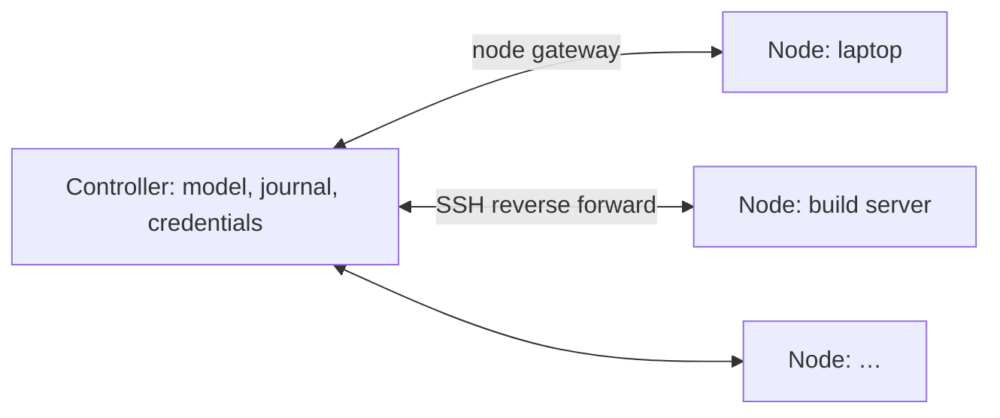

# Run tools on other machines

A session can use every [named node](../user-guide/attaching-a-bot-machine.md)
connected to its controller as if it were one computer. The model loop, the
session journal and provider credentials stay on the controller; a node runs
only the individual tool calls that name it, with that machine's files, shell
and network.



## The `node` argument

When a session's policy allows the `nodes` tool, these built-ins take an
optional `node` argument: `bash`, `bash_output`, `kill_process`,
`process_input`, `read`, `write`, `edit`, `ls`, `grep`, `find` and `eval`.

```json
{"command": "git status --short", "node": "build-box"}
```

- Omit `node`, or pass `"local"`, to run on the controller as before.
- A call naming a node runs there through `coding_agent.tool` and returns the
  same result the tool returns locally. Relative paths resolve against the
  node's working directory (its `--cwd`, normally the home directory).
- Per-session tool state lives on the node and persists between calls: the
  shell's working directory and environment, background processes, `eval`
  kernels and the read tracker `edit` uses. It is released 30 minutes after the
  session's last call on that node.
- Parallel tool calls naming different nodes run concurrently. Routed calls do
  not take the controller's workspace mutation lock.

`nodes` lists the connected nodes with a live host summary (hostname, OS,
architecture, CPUs, memory, user, working directory, Lemon version) and the
tools each one accepts. A node running an older Lemon is listed with
"cannot run tool calls".

## One cell, many machines

Inside an [`eval`](eval.md) cell, `tools.<name>(args)` calls the session's
tools, and a call whose arguments include `node` runs on that node. One cell
can therefore fan work out to several machines and return only the answer:

```js
const nodes = ["newphy", "ophy", "chico"];
const [status, tests, ...load] = await Promise.all([
  tools.bash({ command: "git status --short", node: "newphy" }),
  tools.bash({ command: "mix test 2>&1 | tail -3", node: "ophy", timeout: 600000 }),
  ...nodes.map((node) => tools.bash({ command: "uptime", node })),
]);
({ dirty: status.text, tests: tests.text, load: load.map((r) => r.text.trim()) });
```

```python
import asyncio
results = await asyncio.gather(*[tools.bash(command="uptime", node=n) for n in ["newphy", "ophy"]])
[r["text"].strip() for r in results]
```

The model sees one `eval` call and its output, not one round trip per machine.

`eval` itself can also run on a node (`{"language": "py", "code": "…", "node":
"ophy"}`). That cell runs in a kernel on the node, and its `tools.*` calls run on
the same node; naming a different node from such a cell fails without running.
Run the cell on the controller to reach several machines.

## Failure semantics

| Situation | Result |
| --- | --- |
| No connected node has that name or ID | Error listing connected nodes; nothing ran. |
| The node's Lemon predates `coding_agent.tool`, or does not offer the tool | Error; nothing ran. |
| The node's capability ceiling (`--capabilities`) or the session policy excludes the tool | Error (`forbidden`); nothing ran. |
| The connection drops, the routing deadline passes, or the call is cancelled while running | **Outcome unknown**: the call may have taken effect. It is never retried and never falls back to another machine. |
| The result exceeds the transport limit | Error saying the call ran but its output was too large. |
| Intent append or sync fails on the controller | Tool not run (`not_started`); no node invocation is sent. |
| An effectful request lacks a controller intent marker bound to its call ID | Tool not run on the node; update older controllers before using an updated destination. |

Cancelling a routed call aborts the tool on the node (killing a shell
command's process tree) and stops it after a two-second grace.

The controller, not the node, owns durable tool intent. It syncs a
`lemon.tool_intent` before sending an effectful node invocation, and sends only
an invocation-bound acknowledgement marker alongside the request. Results do
not add a per-result sync. Read-only calls add no intent sync.
Nested tools in a node eval cell are covered by that parent eval's intent only
while it is live; an interrupted parent reports all nested effects as unknown.

## Authority

- The `nodes` tool is the switch. Without it (for example under the
  `read_only`, `safe_mode` or `subagent_restricted` profiles), routable tools
  have no `node` argument and refuse a call that names one.
- The call keeps the session's approval rules: approval is requested on the
  controller with the `node` argument visible. Routed paths are never resolved
  against the controller workspace and never receive folder-read exemptions.
- The destination intersects the transported execution context with its own
  capability ceiling and binds it to its working directory before building the
  tool, exactly as for [`coding_agent.run`](../execution-policy.md#named-execution-nodes).
- Results are marked untrusted on the controller; tool-supplied trust metadata
  from the node is dropped.
- No provider credentials or controller secrets are sent to the node.
- Routed tools cannot reach the node's own credentials through Lemon: shell,
  eval and process children inherit no Lemon secrets, file tools refuse the
  node's Lemon credential files (node tokens, secrets master key and store,
  cookie, `env`/`.env`, control-plane tokens), and bash/eval text naming them
  is refused. Tools run
  as the node's OS user, so code they run is not sandboxed from that user's
  files; withhold `bash`, `eval` and process tools with the node's capability
  ceiling when that matters. See
  [execution-node credentials](../config.md#named-execution-nodes).

## Attaching machines

Nodes join with an invitation and dial out to the controller's node gateway, so
neither side needs an open public port; a loopback-only controller reaches a
private server through an SSH reverse forward. See
[Attaching a bot machine](../user-guide/attaching-a-bot-machine.md). Routed tool
calls work on any attached node whose Lemon advertises `coding_agent.tool`.
